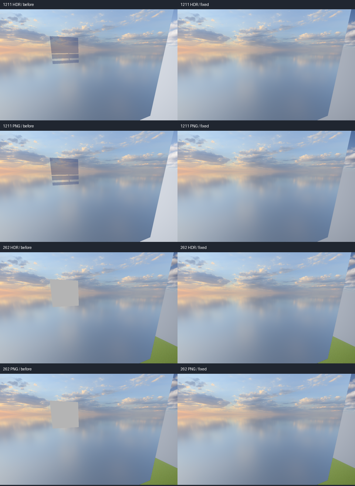

# 自定义天空盒在 ITRP 下的后排轮廓修复

日期：2026-11-08；针对用户提供的 1.21.1 / ITRP 视角截图。

## 结论

此次浅灰盒形轮廓源于自定义天空材质的归属身份缺失。它不是 HDR 解码独有的问题：用普通 8-bit PNG 作为前排自定义天空，同一摆放和视角下同样复现。1.21.1 和 26.2 都有这个身份问题，后续合成路径的具体失效方式略有差别。

修复包：

| 目标 | 版本 | 安装包 |
|---|---|---|
| MC 1.21.1 / Java 21 | 1.0.7-test.2-owner | [JAR](../build/libs/skyboxblock-1.0.7-test.2-owner.jar) |
| MC 26.2 / Java 25 | 1.0.7-test.2-owner-port.1 | [JAR](../mc26.2/build/libs/skyboxblock-1.0.7-test.2-owner-port.1-mc26.2.jar) |

最终包身份、逐场景检查、修复前负对照和构建日志汇总在 [acceptance.json](evidence/custom-owner-20261108/acceptance.json)。

## 根因

旧的 `SkySkin.custom()` 把所有自定义风格的 `material` 都设成 `-1`。GPU 归属纹理中保存的身份是 `material + 1`，所以自定义风格全都写成了 `0`，与空覆盖哨兵值相同，也无法区分彼此。

- 1.21.1 在真实世界深度赢家处用 `GL_EQUAL` 记录归属，本身设计正确；但写入的自定义身份是 0。ITRP 背景注入用 `owner >= 0.5` 判断有效天空，跳过这些自定义面；最终恢复的部分深度兜底也认为它们没有天空归属。后方盒体造成的深度不连续在特定角度下留下浅灰轮廓。后排 custom 还会绕过旧的非负材质检查。
- 26.2 的最终/ITRP shader 直接比较 owner 与 `material + 1`。不同 custom 都是 0，彼此通过相同身份检查，产生后排批次重绘。
- `.hdr` 和 `.png` 在启动导入后都生成相同形式的 PNG 资源，渲染统一走全景采样分支。两种输入均受影响；改变 HDR 曝光、色调映射或图片位深不会恢复丢失的材质身份。

上一轮验证主要覆盖单一自定义风格和普通石柱遮挡，没有覆盖前后不同天空材质。本轮增加同一前排、仅改变后排天空盒的配对场景，并让旧交付包作为必须检出问题的负对照。

## 最小修复

生产逻辑只修改两版 `SkySkin.java`：

1. 内置风格继续使用原 enum ordinal，不改变纯黑/银河/末日的测光 owner 常量。
2. 自定义风格按注册 ID 分配独立非负材质值，起点是内置风格数量；现有内置 9 种，custom 的 coverage owner 从 10 开始。
3. 同一 ID 再次构造或更换纹理资源时复用同一材质身份；两个不同 ID 即使共用一张图片，也保持独立身份。
4. `isCustom()` 根据独立材质区间判断，保留自定义分类；ID 分配只发生于构造/启动注册，不在逐帧绘制中分配。

这些数字只供本进程的渲染归属使用，不保存到 NBT 或网络协议。方块注册 ID、存档、图片、配置和物品名称没有改动。HDR 解码、生产 shader、深度容差、FSR jitter、矩阵、几何和渲染时序均保留；不靠隐藏后方物体、降低透明度或扩大深度容差掩盖问题。

## 验证方法与结果

### 修复前实机反例

在隔离世界放置覆盖整个测试区域的前排自定义天空板，后方放置完全被遮挡的 5×5×5 天空立方体。保持前排、相机和素材不变，分别采集后排为空、灰色 custom、内置纯白、粉色 custom 的画面。

- 1.21.1 + ITRP + FSR2：HDR 与 PNG 各 3 组后排对照，共 **6/6** 组检出缺陷。后方盒投影区域 RGB 平均差约 **30.46–30.72 / 255**，最大差 89–90，约 75% 采样点改变。
- 相同场景的修复包先行复测：**6/6** 组通过，后排投影区域与前排单独存在时像素差为 **0**。
- 26.2 旧包也作为独立负对照运行，必须在 HDR 和 PNG 两种前排中都检出错误；具体结果随汇总 JSON 保留。

### 扩展后台矩阵

两版本分别测试：

- 原生 OpenGL。
- Iris + iterationRP Alpha 0.8.31，不启用 FSR。
- Iris + 同一 ITRP，FSR2 设置为 2。

前排 HDR 和 PNG 各取 4 组 yaw/pitch：`(0,0)`、`(18,12)`、`(-26,-12)`、`(32,18)`；每组对照后排空/灰 custom/内置白/pink custom。另测内置纯白在前、自定义材质在后的反向组合。每环境 36 次采集、27 个有/无后排配对；六环境设计总计 **216 次采集、162 组配对**。

检查器用实际相机矩阵计算前排足迹和后排盒投影，只在确定应被前排覆盖的像素上比较；避开前排外边沿。旧包反例必须失败，修复包要求对应区域最大差不超过 2、平均差低于 0.1。窗口实际可见/聚焦/鼠标抓取状态也被读取，任何一项为 true 则该组不通过。实际通过数和最大误差以汇总 JSON 为准。

**最终结果：六环境 216 次采集完成，162/162 组配对通过，交付审计 42/42 项通过。** 审计同时确认实际光影启用状态、FSR 光栅比例、隐藏窗口/鼠标状态，以及实机安装的 JAR 与交付包 SHA-256 一致。26.2 旧包的 9 组配对中有 4 组失败，覆盖 HDR 和 PNG；1.21.1 旧包 6/6 组反例失败，证明检查器会检出该缺陷。



### 编译与保留功能

- 两版新增 `materialIdentityTest`，各 **545** 条断言，覆盖所有内置 owner、64 个 custom owner、空覆盖隔离、浮点精确表示、同 ID 稳定性、同贴图不同 ID 的隔离及测光常量。
- 1.21.1 `build`、26.2 `build regAll` 成功；既有 HDR 解码、配置、命令、环境、时间、后端与数学回归继续通过。
- 实际 JAR 与上一轮 HDR 包比较，只允许 `SkySkin.class` 及版本元数据变化；测试类不进入生产包。
- 没有新增 GPU pass、纹理、采样或逐帧解码。

测试均使用隐藏窗口、取消鼠标抓取的既有隔离夹具；没有向桌面注入键盘/鼠标事件，也没有替换用户 PCL 的模组、存档或配置。日志中的离线账号查询失败与渲染错误分开检查。DH、门户、其他光影包不借本次矩阵扩为已全面验收。

## 复现

项目根目录（1.21.1 使用 JDK 21，26.2 使用 JDK 25）：

```powershell
.\gradlew.bat build --no-daemon --console=plain
# mc26.2/ 中
.\gradlew.bat build regAll --no-daemon --console=plain
# 返回根目录，用本工作区 Python 环境
python tools/custom-owner-1211.py --label unique-case --jar build/libs/skyboxblock-1.0.7-test.2-owner.jar --profile iris --fsr 2
python tools/check-custom-owner.py build/render-regression/unique-case
python tools/run-custom-owner-matrix.py
python tools/audit-custom-owner.py
```

夹具使用本机已验证的 PCL / JDK / 素材路径；重新运行应采用新 label，保留已有证据。修复前后图片均来自真实最终帧，预览只做缩放与标签排版。
