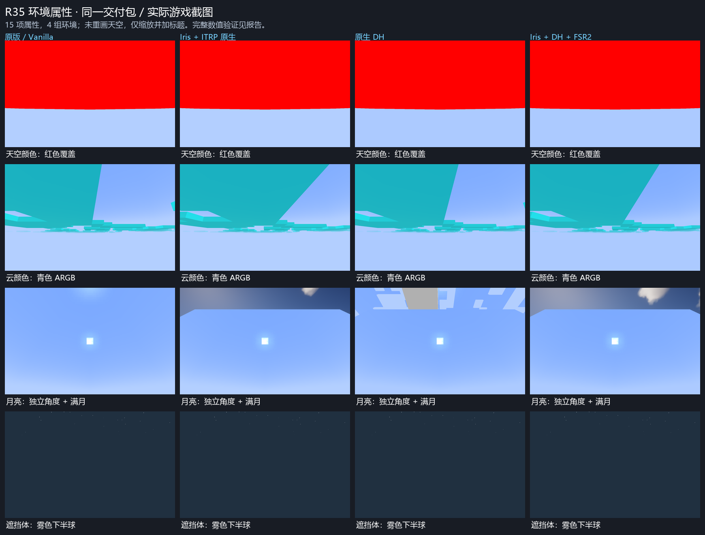

# R35 原版天空盒环境属性交付报告

日期：2026-10-31。版本：**1.0.4-test.1-r35**。结论：**本轮环境属性功能与下列指定环境矩阵通过**；不扩大为整个项目正式发布验收。

## 1. 交付物与身份

- [主模组 JAR](../build/libs/skyboxblock-1.0.4-test.1-r35.jar)
- [源码 JAR](../build/libs/skyboxblock-1.0.4-test.1-r35-sources.jar)
- [完整中文指令手册](VANILLA-ENVIRONMENT-ATTRIBUTES.md)
- [属性规格、来源及版本适配差异](ENVIRONMENT-ATTRIBUTES-R35-SPEC-2026-10-31.md)
- [独立 GPT6.1SOL 命令边界复审](INDEPENDENT-R35-COMMAND-REVIEW-2026-10-31.md)
- [最终机器可读汇总](../build/reports/r35-final-validation.json)
- [实际截图四环境对照](screenshots/r35-environment-comparison-20261031.png)

主包 SHA-256（四次实机使用同一包，测试前后字节不变）：

```text
f1937b9eb21caa1aea2b912bea1c7447eafa2e0f2cd90d116beba99d46291444
```

独立测试 probe SHA-256：

```text
2e61fb12ff542f66962a846f9adf6b7eadc3e6202d3e32f87df816e389e7ca47
```

Probe、测试类、测试世界均不打入主包。最终文件另汇集于工作区 `output/skyboxblock-1.0.4-test.1-r35/`，附 SHA256SUMS 和项目源码／选定证据 ZIP；历史版本与归档原样保留。

## 2. 已实现的指令

```mcfunction
/skyboxblock environment list
/skyboxblock environment get sky_color
/skyboxblock environment set sky_color #7BA4FF
/skyboxblock environment set cloud_color #80FFFFFF
/skyboxblock environment set cloud_height 240.33
/skyboxblock environment set sun_angle 45
/skyboxblock environment set moon_angle 225
/skyboxblock environment set moon_phase full_moon
/skyboxblock environment set star_brightness 0.75
/skyboxblock environment set has_sky_occluder true
/skyboxblock environment reset sky_color
/skyboxblock environment reset all
/skyboxblock reload
```

`env` 是 `environment` 的别名。属性接受短 ID、`visual/<id>`、`minecraft:visual/<id>` 三种写法；TAB 按属性类型与已输入前缀给出合法建议。`set <属性> auto` 与单项 reset 等价。

### 全部 15 项

| 属性（前缀为 `minecraft:visual/`） | 类型与支持范围 | 实际效果 |
|---|---|---|
| `sky_color` | RGB `#RRGGBB` / `0xRRGGBB` | 原版天空盒内天空颜色 |
| `fog_color` | RGB | 私有天空画布雾色／清屏色 |
| `fog_start_distance` | 有限数，−32768..32768 | 天空雾与云淡出起点；允许负值 |
| `fog_end_distance` | >0..32768 | 私有天空雾结束回退值；渲染夹到至少 96 |
| `sky_fog_end_distance` | >0..32768 | 显式设置时优先控制天空雾结束 |
| `cloud_color` | ARGB `#AARRGGBB` / `0xAARRGGBB` | 云色与透明度；A=0 直接跳过云绘制 |
| `cloud_height` | 有限数，−32768..32768 | 最终世界 Y，不重复加 0.33 |
| `cloud_fog_end_distance` | >0..4096 | 独立云结束距离；显式设置时默认起点为 end/3 |
| `sunrise_sunset_color` | ARGB | 霞光颜色与强度；覆盖后允许常显 |
| `sun_angle` | 任意有限 float 角度 | 太阳独立方位；0° 正上方 |
| `moon_angle` | 任意有限 float 角度 | 月亮独立方位；修正旧月亮几何的 180° 反向 |
| `star_angle` | 任意有限 float 角度 | 星空独立旋转 |
| `moon_phase` | 八个月相名称或 0..7 | 原版 4×2 月相纹理网格 |
| `star_brightness` | 0..1 | 星亮度；显式值不再隐式乘降雨衰减 |
| `has_sky_occluder` | `true` / `false` | 雾色下半球平滑遮挡／显式关闭遮挡 |

角度保存用户有限值，绘制前归一化，支持负角与科学计数，避免巨大 float 直接进入三角运算。颜色保留 ARGB 的完整 32 位，未把负的 Java int 当作非法颜色。

## 3. 默认行为与持久化

- **未配置即 auto**，不以新版 Wiki 的静态默认值替换现有 R34.2 天空。时间、天气、生物群系与维度模拟的既有分支保留。
- 原有 `cloudheight`、`clouddistance`、`cloudfade` 与各自 reset 保留。旧 `cloudheight 192` 的最终 Y 是 192.33；新 `environment set cloud_height 192.33` 先换算为名义高度，Java 实测与旧路径逐位等价。
- 新属性键为 `environment.visual/<id>`，保存在本客户端的 `config/skyboxblock.properties`。单项 reset 删除同属性所有别名；reset all 只清环境属性键，保留旧云高／距离以及其他无关配置。
- 同一层多个别名按确定性规则归并，规范 ID 优先；JVM 层先独立归并，再优先于文件层。无效值回到 auto。JVM 覆盖时指令会提示优先级，指令仍保存文件值。
- 原子替换文件，保存失败不污染活跃配置实例。畸形 Properties 的读取回退默认；对已损坏文件的修改失败并保留原文件，而非清空后覆盖。平台不支持 ATOMIC_MOVE 时沿用普通 replace fallback，不承诺该 fallback 的跨崩溃原子性。
- 颜色覆盖视作最终值，不再隐式乘天气灰化；auto 仍沿用旧天气链。日月星不额外吃天空雾。
- 作用范围是**本客户端所有原版天空盒方块**，不是逐方块存储，也不修改世界时间、天气、雾、光照或其他 8 种天空盒。

## 4. 构建与非实机回归

[完整构建日志](../build/r35-build-r4.log)：`BUILD SUCCESSFUL in 43s`，19 个任务，17 执行／2 up-to-date；Mixin 有 3 条既有目标声明风格 warning，无编译错误。

| 可执行回归 | 实测断言 |
|---|---:|
| 既有几何／方向／FSR／云高／配置回归 | 389,385 |
| 新环境渲染数学／月亮方位／遮挡体几何 | 42,257 |
| 15 项注册表、解析、快照 | 279 |
| 真实 Brigadier 命令与旧接口 | 619 |
| SOL 独立持久化／解析边界，16 组用例 | 1,005 |
| **合计** | **433,545 / 433,545** |

另外：[最终静态合同审计](../build/reports/r35-environment-audit-final.json) **97/97**（含最后增加的 4 项 ID 形式／不支持形式交叉检查）；[实际包审计](../build/reports/r35-package-audit.json) **58/58**。全部既有 PNG、10 个受保护渲染管线 class 及受保护 HDR／合成／日月星 shader 与冻结 R34.2 包逐字节相同。第三方 NOTICE 使用工作树原有的 2026-10-24 署名增补，不回写旧包。

独立 `verify-javac.ps1 -Tag r35-final-quoted` 也成功编译 **48 个主源码文件**。该工具原有的 Start-Process 参数未引用带空格 classpath，现已修正并保留 UTF-8 BOM；最初的 classpath／引号失败没有被归因于渲染源码。

## 5. 真实客户端矩阵

Minecraft 1.21.1／Fabric，隔离新实例、新世界；每组执行 **57 场景、203 条真实客户端命令、371 项运行检查**。

| 环境 | 场景完成 | 运行检查 | 游戏退出码 | ERROR 备注 |
|---|---:|---:|---:|---|
| 纯原版 Fabric | 57/57 | 371/371 | 0 | 1 条离线公钥拉取告警 |
| Iris 1.8.1 + Sodium 0.6.7 + ITRP Alpha 0.8.31，原生 | 57/57 | 371/371 | 0 | 1 条离线公钥拉取告警 |
| 原生 Distant Horizons 3.3.3 | 57/57 | 371/371 | 0 | 0 |
| Iris／Sodium／DH／ITRP，FSR2_SCALE=2 | 57/57 | 371/371 | 0 | 0 |
| **合计** | **228/228** | **1,484/1,484** | — | **2 条认证服务告警原样保留** |

真实证据包括：

- 完整 15 项设置、文件读回、reload、非法输入不修改已保存配置、单项／全部 reset、旧配置被覆盖及恢复。
- 实际天空颜色／雾色像素，雾起止 GPU uniform、96 下限、云 alpha GPU uniform、全透明云画布与独立无云对照。
- 独立太阳／月亮视角；八个月相的实际画布八种不同；星角与亮度以高反差星像素而非整屏均值验证；雨量 >0.9 时显式星亮度 1 对应 GPU DrawColor `[1,1,1,1]`。
- 霞光 ARGB、雾色渐隐遮挡体、所有属性 reset 后的动态天空状态恢复。
- 其他 8 款天空盒逐款对照：环境覆盖前后最终屏幕中心区域差异均在检查预算内。
- 真实方块几何被收集、采样 GL 错误为空、被采样私有事务状态恢复失败为 0；不是只查日志里的“执行过”。

[原版检查](../build/reports/r35-runtime-vanilla.json) · [Iris 原生检查](../build/reports/r35-runtime-iris-native.json) · [原生 DH 检查](../build/reports/r35-runtime-dh.json) · [FSR2 检查](../build/reports/r35-runtime-iris-dh-fsr.json)

**告警口径：** 前两次保留精确的 `Yggdrasil Key Fetcher/ERROR: Failed to request yggdrasil public key`。通用旧运行器把任何 ERROR 都算失败，因此它们的严格 runner 返回 1；游戏进程实际退出 0，57 场景完整。独立 R35 检查器仅对这条明确的离线认证服务错误分类记录，其他 ERROR、fatal、GL 或状态恢复失败仍判失败。这里不写“全部日志 0 ERROR”。

**检查器自身的修正也留证：** 初版误把 RGB 的隐含 FF alpha 当作错误、未处理重映射 Vec3 字段名、把累计云绘制计数跨场景对比误当作全透明阶段计数，并给稀疏星像素设置了整屏均值门槛。后续按真实数据模式修正，保留早期失败报告；未改变主包或原始截图以迎合检查。全透明云的无深度绘制还由实际 alpha=0 快照与生产代码早退合同共同核实，不用跨场景累计计数冒充逐阶段 GPU 证明。

## 6. 版本适配边界

这是 **1.21.1 的私有天空画布适配层**，不是新版环境属性引擎整体回移。保留 auto 基线；4096 云距离上限、私有画布雾距回退、常显霞光、雾色平滑遮挡体等差异见规格。属性来源以用户指定社区 Wiki 为准，社区版本转述与 minecraft.net 原文不混称。

世界光照类 `sky_light_color`／`sky_light_factor`、水下雾、音频及 gameplay 属性不属于此天空画布配置，未借本任务修改世界效果。没有修饰符链、时间线或新版属性插值引擎。

历史严格恢复的 4 个红项、门户矩阵、资源／性能长测没有借本轮重新签为通过；动态真实 LOD 遮挡仍引用先前 R30 的有范围证据。本轮 DH 结论限于上述环境属性矩阵与未改动的受保护管线。

未替换用户已安装 JAR、原光影 ZIP、配置或存档；未 commit、push 或上传。

## 7. 复现

在项目根目录，使用项目已有 Mojang JDK／本地路径配置：

```powershell
powershell.exe -NoProfile -ExecutionPolicy Bypass -File tools/build.ps1 -Task build
powershell.exe -NoProfile -ExecutionPolicy Bypass -File tools/build.ps1 -Task remapR30ProbeJar
powershell.exe -NoProfile -ExecutionPolicy Bypass -File tools/verify-javac.ps1 -Tag r35-recheck
python tools/check-r35-environment.py --json build/reports/r35-environment-audit-final.json
python tools/run-r35-environment.py --jar build/libs/skyboxblock-1.0.4-test.1-r35.jar --profile vanilla --label unique-r35-vanilla
python tools/check-r35-runtime.py build/render-regression/unique-r35-vanilla --output build/reports/unique-r35-vanilla.json
python tools/verify-r35-package.py
```

本机 PATH 上的 `python` 可能是 Windows Store 存根；实际运行使用 DSH 提供的 Python 完整路径。Iris／DH 参数及完整四环境 label 记录在各隔离实例的 `r30-owned.json`，所有主包哈希在最终汇总中一致。

