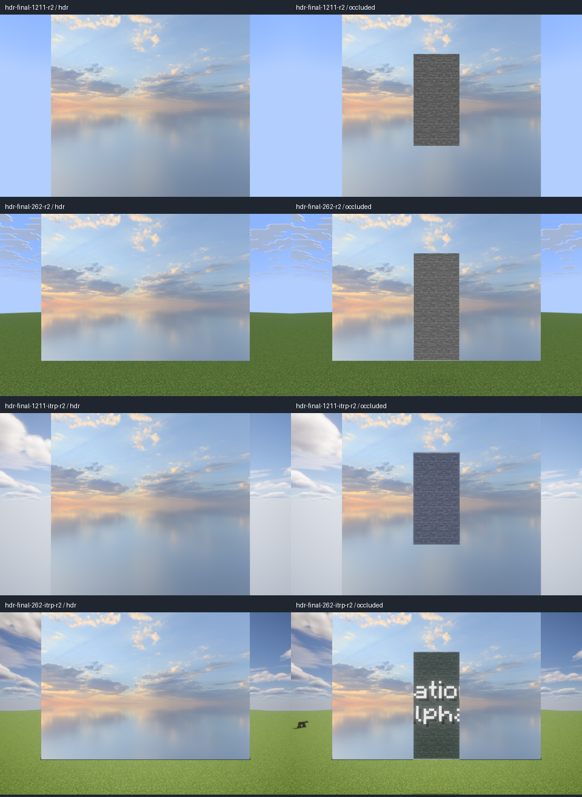

# HDR 素材导入与指令本地化交付

日期：2026-11-08（Asia/Shanghai）；任务从 2026-11-07 晚间开始。

## 结果与安装包

| Minecraft | 构建版本 | 安装包 |
|---|---|---|
| 1.21.1 / Fabric / Java 21 | 1.0.7-test.1-hdr | [主线 JAR](../build/libs/skyboxblock-1.0.7-test.1-hdr.jar) |
| 26.2 / Fabric / Java 25 | 1.0.7-test.1-hdr-port.1 | [26.2 JAR](../mc26.2/build/libs/skyboxblock-1.0.7-test.1-hdr-port.1-mc26.2.jar) |

实际包 SHA-256、逐项验收与旧版渲染字节对照见 [acceptance.json](evidence/hdr-import-20261108/acceptance.json)。本轮只生成构建产物与隔离测试实例，没有替换 PCL 用户实例的模组、配置、存档或光影包，也没有提交或推送 Git。

## 支持的图片和处理方式

自定义 `picture` 现在支持 `.png` 与 Radiance RGBE `.hdr`，扩展名大小写不敏感，仍只接受当前 `skyboxes/` 目录内的文件名。配置结构、启动注册、manifest 和资源包注入方式延续原功能。

```conf
enable = true

my_hdr_sky = {
    id = "skyboxblock:my_hdr_sky"
    picture = "我的全景图.hdr"
    creative_inventory = true
    lang_zh_cn = { name = "我的 HDR 天空" }
    lang_en_us = { name = "My HDR Sky" }
}
```

- 目录仍是 `<gameDir>/config/skyboxblock/skyboxes/`；修改配置和素材后重启游戏。
- PNG 保持原 16 MiB 上限；HDR 为 40 MiB，容纳 4096×2048 未压缩 RGBE 以及本轮 17,385,661 字节的真实 4K 素材。两者尺寸上限仍为 4096×2048。
- 新式逐通道 Radiance RLE、平坦 RGBE 数据、两种轴顺序与符号方向均有处理；同时校验头长度、尺寸、游程计数、扫描线长度和截断。XYZE、EXR、旧式 `(1,1,1,count)` RLE 不在此解码器的支持范围内，格式不符时跳过该风格并保留诊断，不生成错误纹理。
- 输入 RGBE 按线性辐亮度解码；用最多 64×64 个确定性采样估计中位亮度，曝光为 `0.45 / max(medianLuminance, 1e-6)`；按亮度做保持色度的全局 Reinhard 映射，再编码为 sRGB。左右羽化、32×32 物品图标、资源包生成和现有采样路径随后照常运行。
- 这是 **HDR 素材导入后生成 8-bit sRGB 显示纹理**。没有把最终显示或整个游戏合成改成浮点 HDR，也没有增加 EXR 解码。导入时的高动态范围先参与曝光与色调映射，再交给既有显示管线。
- 解码只发生于启动注册阶段：两遍扫描、复用单条扫描线、最多 4096 个亮度样本，没有整幅浮点 RGB 缓冲；运行时没有新增文件读取、解码、额外 GL pass、浮点纹理、采样次数或 shader 分支。

## 先主线后移植

1. 在 1.21.1 接入解码器、`.hdr` 校验和 40 MiB 上限，复用原图像生成链。
2. 复核并修正了最初实现的 X-first 扫描轴问题：X-first 光栅实际按列存储，回归样本也改为真正转置的数据，而非只修改分辨率头。
3. 将解码器和 HDR 测试源码逐字节复制到 `mc26.2/`；注册器只保留既有 Identifier/ResourceLocation、资源包版本和物品模型入口差异。源码一致性由交付审计再次确认。
4. 生产 shader、既有全景素材、世界几何、遮挡与 Iris/FSR 采样主体保持原样；实际 JAR 内的渲染类与资源对照结果写入验收 JSON。

## 验证

### 编译与纯逻辑

- 1.21.1：完整 `build` 成功，并运行既有环境、时钟、数学、服务端命令与持久化回归。
- 26.2：完整 `build regAll` 成功，包括原有本地化、天空语义、反投影、环境和时间回归。
- 两版 HDR 解码各 **3,734** 条断言，配置解析各 **189** 条断言。
- `check` 已纳入 `hdrDecoderTest`、`customSkyConfigTest`、`hdrRegistryTest`；默认注册器检查各 24 条，另一次带真实 4K 输入的检查各 **26** 条。
- 真实 4K 图像经过生产注册器后的纹理 SHA-256 在两版相同：`0ab80b67e26e32ef1354ef0419ac1e8141bf3b2f9a6ab4db0dc02ad3caa4cf4f`。
- 该 4K 图像的单次启动导入全流程测得约 **1.51 秒 / 1.39 秒**（1.21.1 / 26.2，含解码、羽化、PNG 与图标生成；本机单次测量）。

### 最终包后台实机矩阵

| 环境 | 检查 |
|---|---|
| 1.21.1 原生 | HDR / PNG 对照、石柱遮挡、真实客户端指令打开文件夹 |
| 1.21.1 Iris + ITRP Alpha 0.8.31 + FSR2 | 同上 |
| 26.2 原生 OpenGL | 同上，另在 en_us 下检查真实服务端帮助与时间参数错误英文反馈 |
| 26.2 Iris + ITRP Alpha 0.8.31 + FSR2 | 同上 |

每组均通过最终包身份校验。每个显示 oracle 取 3,185 个像素，用实际 VP 逆矩阵独立重建球面方向，再对生成全景做双线性采样；同时检查 HDR/PNG A-B、遮挡、窗口状态和真实文件夹位置。经度偏移 90° 的负对照用于证明检查器会检出错误方向。实际误差、帧时与逐项布尔结果见四组证据 JSON。



最终包审计共 **27/27** 项通过；主线 **141** 项、26.2 **150** 项既有渲染类/资源与原发布基线逐字节一致。26.2 的 ITRP 遮挡图中可见光影包自身的短时开场标题（包内 `MotionBlur_FS.glsl` 的 `title` 逻辑），没有为清理画面而修改光影包或实拍像素。

测试全程使用隔离新世界，不发送桌面键盘/鼠标输入。1.21.1 的不聚焦/不抓鼠标 mixin 只在单独验证 probe JAR 内；26.2 沿用原有显式启用的文件夹具。采集时实际 `windowVisible`、`windowFocused`、`mouseGrabbed` 均为 false。

性能结论的依据是运行时路径与实际渲染二进制保持原样，以及同分辨率 HDR/PNG 对照资源与帧时检查；测量为各 5 秒、60 FPS 上限的 CPU 帧间隔，不能当作不限帧 GPU 跑分或任意硬件/任意光影的长期性能认证。26.2 离线测试中的账号属性、Realms、证书查询 ERROR 单独列在证据中，不算渲染错误，也没有省略。

### 文件夹打开

`/skyboxcustom` 与 `/skyboxcustom open` 走同一目录打开逻辑：使用标准化的绝对目录路径、验证目录存在、保留可点击路径。26.2 改用该目标版本实际存在的 Minecraft 平台打开 API，避免 AWT/headless 状态导致打开失败；失败分支不再同时输出“已打开”。

最终验证通过真实客户端 dispatcher 执行命令，再由 Windows Shell COM 枚举新 Explorer 窗口，读取实际 `LocationURL` 并与该隔离实例的 `skyboxes` 目录逐路径比较。仅匹配测试目标的新窗口才被隐藏并关闭。证据不是仅靠命令返回值或聊天“已打开”文字。

## 指令英文与中文

- `/skyboxcustom`：10 个反馈/悬停/目录与列表键，均通过 translatable Component 提供 en_us / zh_cn。
- `/skyboxblock`：39 个服务端帮助、描述、读写结果和时间参数错误键；两版同名语言键、占位符与对应取值一致。中文 fallback 保持无语言表的专服控制台和既有回归可读。
- 属性 ID、preset、`id = value`、`time = ticks / mode` 保持原有机器可读数据。其他后端抛出的诊断原因作为参数保留，少数非法输入的详细原因仍可能为中文；没有为翻译重写校验或持久化逻辑。
- 静态验证工具：[verify-command-locales.py](../tools/verify-command-locales.py)，校验键集、源代码引用、占位符个数、中文 fallback 和跨版本一致性。

## 复现入口

```powershell
# JDK 21，主线
.\gradlew.bat build remapR30ProbeJar --no-daemon --console=plain

# JDK 25，mc26.2/
.\gradlew.bat build regAll --no-daemon --console=plain

# 回到项目根，使用带 NumPy/Pillow 的 Python
python tools/verify-command-locales.py .
python tools/verify-hdr-import.py --java "<JDK21>/bin/java.exe" --hdr "<4K Radiance HDR>"
python tools/verify-hdr-import.py --project mc26.2 --java "<JDK25>/bin/java.exe" --hdr "<4K Radiance HDR>"
python tools/hdr-final-matrix.py
python tools/audit-hdr-delivery.py
```

实机脚本沿用本工作区已验证的 PCL、JDK 与素材路径；换机器需要调整对应入口。不要对已有 label 重跑，既有证据目录会被保留，应使用新 label。此前 `HDR-SUPPORT-TEST-2026-11-07.md` 和它的证据目录属于接手时既有的只读支持性测试，本轮保持不变。

协作记录：用户优先的 xyjun DeepSeek 路由在该会话不可达，按后续指示使用官方 `deepseek-official/deepseek-flash` 完成初版解码器和服务端本地化；已派出的 GPT 子任务保持原样。主代理完成解码器审阅/修正、两版接入、后台夹具、最终构建和验证。
