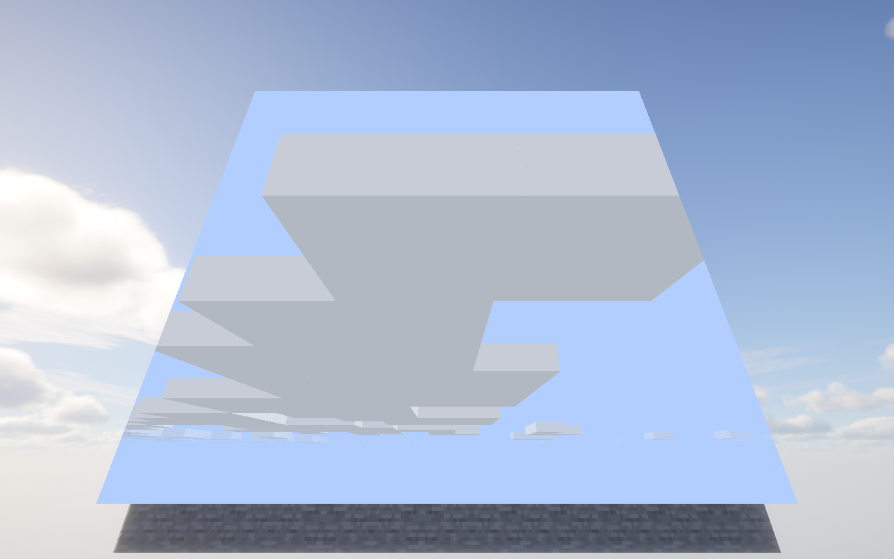
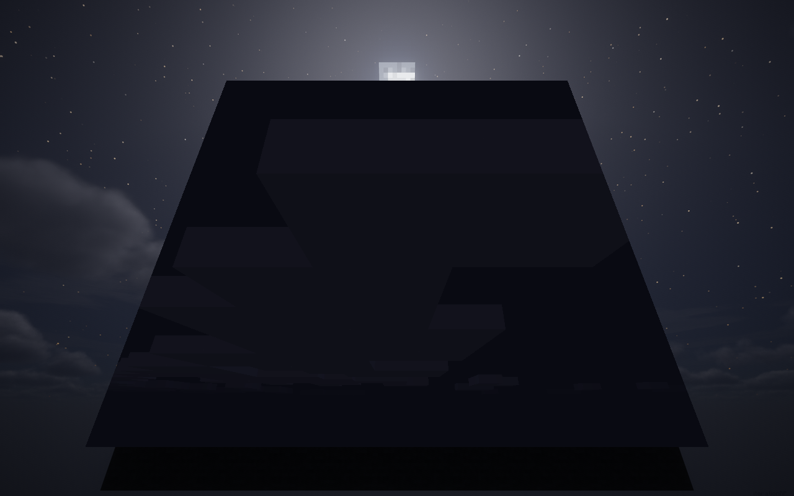

# ITRP 原版天空与原版云实测（2026-10-19）

## 当前验收标准

按用户澄清：启用光影时，天空方块显示原版天空可以接受；要求渲染正常、观感合适，并在方块内显示原版云。与外部 ITRP 天空不同的颜色、云形，不再作为失败项。

## 测试环境与结果

实际启用的包：**iterationRP Alpha 0.8.31**。不是只把文件放进目录；日志明确报告 `Using shaderpack: iterationRP Alpha 0.8.31.zip`。

| 环境 | 场景数 | 像素断言 | 客户端退出 | 渲染线程异常 |
|---|---:|---:|---:|---:|
| Iris 1.8.1 + Sodium 0.6.7 + ITRP | 17 | **29/29** | 0 | 0 |
| 上述组合再加 IP + DH 3.3.3 | 6 项云专项 | **23/23** | 0 | 0 |

IP 的 jar 名为 6.0.7，运行时/Core 实际报告 6.0.6；记录以运行时为准。

**日志范围说明：**单独 Iris + ITRP 组 ERROR 为 0。带 IP + DH 的组合在世界登录阶段有 4 条 `Chunk loading failure`，发生于测试场景开始前，归因仍待确认；没有把组合日志描述成“零错误”。云层和遮挡的像素断言均通过。

## 画面检查

### 白天



- 云使用游戏本身的纹理、网格生成器与昼夜颜色，独立绘制到天空探针。
- 没有调用 Iris/Sodium 接管后的整套云渲染，也没有把光影云或地形抓进方块。
- 单独 ITRP 组：探针中新增约 **283,087** 个云像素，其中方块可见区域内约 **249,295** 个；不是“执行了 draw 但画面没有云”。

### 夜晚



原版云平均 RGB 从白天 **194.133** 降到夜晚 **19.403**。夜间较暗是原版昼夜颜色，不再沿用白天的白云缓存。

## 精确检查项

- 天空探针到方块内画面的平均 RGB 对齐误差：**0**。
- 资源重载后对齐误差：**0**。
- 窗口改为 1024×768 后对齐误差：**0**。
- 石墙完全挡住天空方块：新增屏幕像素 **0**，没有透墙。
- 清除测试方块后：残留覆盖像素 **0**。
- 所有捕获点的前后 GL error：**0**。
- 原版云关闭对照组：6 场景、18/18 断言通过，云新增像素 **0**、云绘制计数 **0**，没有复用脏缓存。

以上是正确性回归，不把窗口设置的 90 FPS 上限当成性能基准结果。

## 复现命令

在项目根目录，用本机已配置的 Python 执行：

```powershell
python tools/render-regression.py --profile iris --shader "iterationRP Alpha 0.8.31.zip" --label my-itrp
python tools/check-render-regression.py build/render-regression/my-itrp/results

python tools/render-regression.py --profile compat --shader "iterationRP Alpha 0.8.31.zip" --suite clouds --label my-itrp-compat
python tools/check-render-regression.py build/render-regression/my-itrp-compat/results
```

工具创建工作区内的隔离实例和新测试世界，不打开用户原存档。组合夹具仅关闭 DH 的联网更新检查，以避开进入世界前的网络等待；LOD 渲染没有因此关闭。

## 证据文件

- [ITRP 像素报告](../build/render-regression/clouds2-itrp-pixel-report.json)
- [ITRP 客户端运行结果](../build/render-regression/clouds2-iris-iteration/run-result.json)
- [实际启用 ITRP 的日志](../build/render-regression/clouds2-iris-iteration/client.log#L96)
- [IP + DH 组合像素报告](../build/render-regression/clouds3-compat-pixel-report.json)
- [ITRP 组合运行结果](../build/render-regression/clouds3-compat-itrp/run-result.json)
- [云关闭对照与原版环境报告](../build/render-regression/clouds2-vanilla-and-off-pixel-report.json)
- [数学回归结果](../build/reports/render-math-regression.txt)：252,116 个断言、30,000 个裁剪面、1,000 条逆 VP 射线、六面朝向、无效数值与配置覆盖均通过。

## 本轮边界与后续工作

本次“IP + DH 通过”指**同时安装时的主视角云层与遮挡测试**。门户内部渲染、跨维度/嵌套门户、透明前景合成和 DH LOD 地形遮挡仍是独立待办，未把它们冒充成已经完成的兼容项。

## 实际交付版本复测

[skyboxblock-1.0.1.jar](../build/libs/skyboxblock-1.0.1.jar) 已完成完整 `build`（含数学回归，12 秒，退出码 0），并用**该实际产物**再启动一次 ITRP 云专项：6 场景、23/23 断言、ERROR 0、渲染线程异常 0，退出码 0。

- [交付版本像素报告](../build/render-regression/release101-itrp-pixel-report.json)
- [交付版本运行结果](../build/render-regression/release101-itrp/run-result.json)
- SHA-256：`1832f12c1473e2d57416aeda7dcc0b904a8fe5b06355cdd71ef14e4e90f96bf3`。
- jar 包含独立云 shader 与 MIT 声明，没有重新分发 Minecraft 云贴图。

修复版源码和构建产物保留原版天空方案；用户原参考实例的配置与存档未修改。
