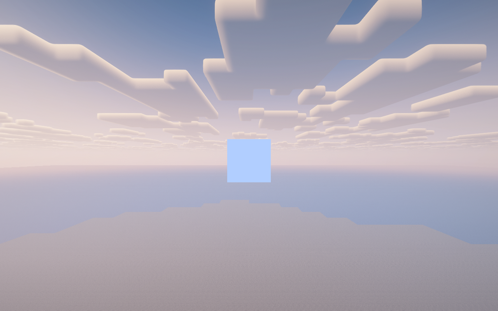

# 对照原始提示词的验收检查（2026-10-18）

## 最新用户澄清（本节优先于下面的历史检查假设）

用户明确接受：**启用光影时方块显示原版天空没有问题，以渲染正常、观感合适为准；希望进一步在光影状态下显示原版云。**

因此，下文“与光影最终天空背景对齐”的差异数据保留作为历史测量，**不再作为失败项或必须修成同包天空的要求**。后续主线调整为：保留已验证的原版天空投影、修正常规几何/遮挡/多模组渲染，并把原版云独立合成进天空探针；不擅自扩展为逐项复制 Shadered 的全部样式与动态系统。

## 结论（澄清前的检查记录）

**当前工程是参考两类天空方块思路的 Fabric 独立实现，尚未达到“光影 / 沉浸式传送门 / 遥远的地平线完整兼容”的验收状态。**

判断依据应是实际功能与画面，而不是“已装进同一个实例”或 README 中的勾选。新增预设外观、能编译、主视角显示正常，均不等于原需求已经完成。

## 原始任务

> 参考 Shadered 与 Literal Sky Block，制作 Minecraft 1.21.1 Fabric 的天空盒方块模组；保留同类方块效果，并兼容光影、Immersive Portals、Distant Horizons；参考 Rapid Optimization 实例版本；注意来源许可。

没有把“只有主视角支持”“用静态图片代替动态效果”“只保证共存启动”列为用户认可的降级条件。

## 逐项检查

| 原需求 | 当前证据 | 状态 |
|---|---|---|
| Minecraft 1.21.1 / Fabric | 构建设置、模组元数据、独立客户端启动验证一致 | 已达到平台要求 |
| 天空方块与虚空方块 | 已注册，方块实体渲染正常；虚空像素最大 RGB=0 | 已实现基础功能 |
| Literal Sky Block 类的天空投影 | 上游 shader 使用 `textureProj`，本项目实时屏幕投影与此思路一致 | 思路吻合；云与天气等范围仍须对照 |
| Shadered 的“同样效果” | 当前 6 张原创预设全景图与原项目动态渲染/样式清单不等价 | 只是同类重实现，不是 1:1 移植 |
| Iris 启用光影包 | 帧末合成后绘制，跳过光影后处理；专项组合检查见下文 | 尚未作为完整兼容验收 |
| Immersive Portals | BER 显式跳过所有非根视角，门户内方块没有进入绘制队列 | 核心缺口：门户内部渲染尚未实现 |
| Distant Horizons | 检测安装状态、历史共存记录；没有 LOD 地形遮挡专项断言 | 共存证据，不是完整 LOD 兼容证据 |
| 指定参考实例 | Iris 1.8.1、Sodium 0.6.7、DH 3.3.3；IP 的 jar 名为 6.0.7，但 Fabric/Core/握手实际报告 6.0.6 | 按运行时版本记录，不只看文件名 |
| 许可与来源 | Literal Sky Block MIT 署名已保留；Shadered 参考分支与许可说明有偏差 | 文档与来源说明需要更正 |

## 严重缺口与定位

### P0：门户兼容被缩成“仅主视角共存”

- [BER 根视角过滤](../src/main/java/dev/yg/skyboxblock/client/SkyBlockEntityRenderer.java#L29-L32)主动跳过门户视角。
- [README 当前限制](../README.md#8-仍待完成)明确记录门户内不显示，却在实测表中笼统给 Immersive Portals 标记通过。
- 正确验收需要：从门户外看另一侧的天空方块、跨维度不同天空、斜视与嵌套门户，且纹理/矩阵/深度/裁剪各自属于对应 pass。
- 直接删除根视角过滤也不构成修复：那会把不同相机与维度的几何、天空混进一个主视角队列。

### P0：光影兼容需要按实际启用的包验证

- “Iris 已安装”“光影开关关闭”“光影包正在运行”是三个不同状态。
- 当前绘制发生在 Iris 合成之后；预设样式不参与该包的曝光、色调映射、TAA、景深等处理。
- 实时天空在地形前抓取，而最终外部天空可能经过若干后处理；画面颜色一致性应由截图与采样数据证明。
- 本轮开始时已先完成“无光影包”的基线与修复对照；启用光影的结果单列，绝不混用。

### P1：Shadered 效果并未逐项等价

- 工作区旧参考的天空类型清单包括 SPACE、STORMY、OCEAN、LIGHT、END、IRIDIA、END_SKY、ECLIPSE、FOREST、MIMIC；1.21.1 上游注册表也包含这 10 类。
- 本项目提供 REAL、SPACE、OCEAN、FOREST、STORMY、END、AURORA、VOID；数量、类型和素材不同。
- [预设生成器](../tools/gen-sky-styles.py#L27-L42)生成原创静态全景图；例如海洋波纹和风暴闪电被画进图片，并非原项目的动态场景。
- 原提示词允许参考、移植或兼容的实现路线，并未要求整个 Shadered 的其他系统；但当前成品应明确称“同类独立实现”，而不是“等效完整移植”。

### P1：普通渲染场景仍需补齐

- 玻璃/水等透明前景的合成顺序需要专项验证；已有基线中，玻璃前景会让其后的天空方块失去可见贡献。
- LOD 地形、半透明方块、选框、第一/第三人称、资源重载、窗口尺寸变化、维度切换均应纳入回归。

## 上游分支与许可检查

### Literal Sky Block

- 上游主分支提交：`415197984bbbf941fe40f61755fd25de98c91aad`。
- [上游许可](https://github.com/latvian-dev/literal-sky-block/blob/main/LICENSE.txt)是 MIT，版权人为 Kristiāns Micītis。
- 本项目 [LICENSE](../LICENSE#L1-L24)保留该版权与 MIT 条款；构建脚本将许可加入 jar。

### Shadered

- 当前上游默认分支是 `GLASS-test`；并另有明确的 `1.21.1` 分支，提交 `02e330c933f57c857848248f7af0fa2d3a43be45`。见 [分支列表](https://api.github.com/repos/Noodlegamer76/Shadered/branches)。
- 工作区现有参考的 [gradle.properties](../../reference/shadered/gradle.properties#L9-L20)是 Minecraft 1.20.1 / Forge，不是 1.21.1 分支。
- 同一旧参考的 [模组许可元数据](../../reference/shadered/gradle.properties#L50-L62)写 `All Rights Reserved`，而其 [LICENSE.txt](../../reference/shadered/LICENSE.txt#L1-L28)是 Forge 的 LGPL 模板。仅凭模板就把整个 Shadered 定论为 LGPL 2.1，不严谨。
- [1.21.1 分支构建元数据](https://github.com/Noodlegamer76/Shadered/blob/1.21.1/gradle.properties)声明 `Attribution-NonCommercial 4.0 International`，并使用 NeoForge；根目录列表中没有独立 LICENSE 文件。应按所取版本与具体文件记录来源，避免沿用旧分支结论。
- 当前项目走原创代码/素材的同类实现路线；现有 MIT 声明不自动覆盖未来引入的 Shadered 源码、shader 或贴图。

## 本轮已经修好的、具有像素证据的问题

独立实例位于 `build/render-regression/`，世界由工具生成，没有打开或修改用户原存档。

| 指标 | 修复前 | 修复后（原版 Fabric 与 Iris 无包分别相同） |
|---|---:|---:|
| 经度接缝平均 RGB 误差 | 5.13815 | 0.00042 |
| 近距离拐角平均 RGB 误差 | 13.63150 | 0.00004 |
| 实时天空昼夜变化 | 0.00000（缓存冻结） | 200.24772 |
| 白天/夜晚与天空背景对齐误差 | 40.18482 / 227.12561 | 0 / 0 |
| 独立像素断言通过数 | 每组 5/10 | 每组 10/10 |
| 修复版客户端 ERROR | — | 两组均 0 |

证据：[修复前报告](../build/render-regression/baseline-pixel-report.json)、[首轮修复报告](../build/render-regression/fixed1-pixel-report.json)、[原版修复运行结果](../build/render-regression/fixed1-vanilla/run-result.json)、[Iris 无包修复运行结果](../build/render-regression/fixed1-iris/run-result.json)。

以上结果只说明基础故障已修复，不代替门户内部、光影包与 DH LOD 专项验收。

## 启用光影与模组组合检查

三个组合实例均完成 12 个场景，进程退出码 0；**像素验收均为 8/10，未通过实时天空背景对齐**。完整数据见 [组合像素报告](../build/render-regression/audit-all-compat-pixel-report.json)。

| 组合（均有 Sodium + IP + DH） | 场景数 | 像素断言 | 白天 RGB 对齐误差 | 夜晚 RGB 对齐误差 |
|---|---:|---:|---:|---:|
| Iris 无光影包 | 12 | 8/10 | 25.57562 | 5.69443 |
| Complementary Reimagined r5.9.3 | 12 | 8/10 | 31.23128 | 35.59982 |
| iterationRP Alpha 0.8.31 | 12 | 8/10 | 30.06724 | 22.91041 |

**观察到的不是仅有轻微色差：**两套光影下，方块都还是原版天色的矩形，外部已有光影云层与不同的天空颜色。当前抓帧点没有取得光影包最终合成的完整天空。当前“抓帧即可兼容任意包”的实现前提不成立。

对照截图：[iterationRP 实机](../build/render-regression/audit2-compat-iteration/results/live-day.png)、[基础接缝修复前后](screenshots/regression-20261018-longitude-seam-before-after.png)、[基础昼夜冻结修复前后](screenshots/regression-20261018-live-night-before-after.png)。以上图片均已实际读取检查。

### 组合运行的附加发现

- 三组均有 4 条 `Chunk loading failure`；尚未取得归因证据，不把它们擅自归到天空盒，也不把整组日志称为零错误。
- iterationRP 组另有更新服务的 Modrinth 连接超时。来源见 [运行结果](../build/render-regression/audit2-compat-iteration/run-result.json)。
- 无包组合的退出日志暴露了本轮新增资源释放回调在网络线程执行的异常：[原始栈](../build/render-regression/audit2-compat-no-pack/client.log#L559-L568)。源码已改为 `client.execute(SkyProbe::release)`，当前构建通过；对应组合的退出回归待复测。
- IP 的运行时版本、Core 与握手均是 **6.0.6**；jar 文件名虽为 6.0.7，也按运行证据记录。见 [加载清单](../build/render-regression/audit2-compat-no-pack/client.log#L58-L72)与 [握手日志](../build/render-regression/audit2-compat-no-pack/client.log#L290-L295)。
- DimLib 与 cloth-config 实际内嵌在 IP jar 中；回归工具已按该真实依赖关系准备实例，而不是寻找不存在的独立 DimLib 文件。

## 后续验收顺序

1. 先修正启用光影后的天空来源与合成时机，不以原版天色或静态图替代最终光影天空。
2. 实现每个门户视角独立的天空、矩阵、几何与深度/裁剪上下文，覆盖跨维度及嵌套门户。
3. 单列 DH LOD 遮挡与透明前景测试，补齐选框、手部、重载、尺寸与维度切换。
4. 对照 Shadered 1.21.1 的具体天空效果清单核验动态性与外观，标注原创扩展与未等价项。
5. 更新 README、模组描述与许可来源清单，最后再把完成兼容验收的 jar 作为最终交付。

本轮检查结束时：当前源码完整构建成功（`BUILD SUCCESSFUL in 12s`），未覆盖安装到原参考实例，未打开或修改用户原存档。此次交付是**验收检查报告与修复证据**，不是“完整兼容已完成”的交付结论。
